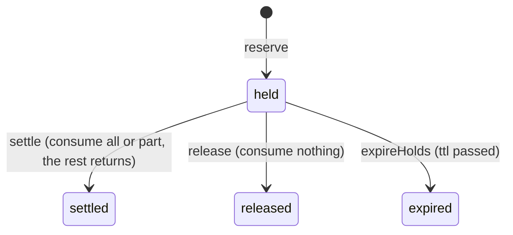

# credit-ledger

[](https://github.com/alissonramosz/credit-ledger/actions/workflows/ci.yml)
[](LICENSE)

Reserve, settle and release credits for work that takes time, can fail and gets retried, such as AI generation jobs.
TypeScript, no runtime dependencies, with an in-memory store and a PostgreSQL store.

## The problem

When a job costs credits, simply subtracting at the start or at the end goes wrong:

- **Charge at the start:** customers pay for jobs that fail.
- **Charge at the end:** a customer with credits for one job can start ten.
- **Retries and duplicated webhooks:** the same job is charged, or refunded, twice.

`credit-ledger` keeps a small, auditable balance with **holds**: credits are set aside before the work starts, then consumed or returned when it ends.

## How it works



Each account has two numbers: `available` credits that can be reserved, and `held` credits set aside by open holds.

- `reserve` moves credits from `available` to `held`. It fails when there are not enough.
- `settle` consumes what the job used. If it used less than it held, the difference goes back to `available`.
- `release` returns everything: the job failed or was cancelled.

Every write takes an **idempotency key**. Repeating a call with the same key and the same arguments returns the first result (`replayed: true`) and changes nothing, so retries are safe.

## Install

Not on npm yet. From GitHub (Node 20 or newer; it builds on install):

```bash
npm install github:alissonramosz/credit-ledger
```

For PostgreSQL, also install `pg` (or any client with the same `connect()`/`query()` shape).

## Quick start

```ts
import { Ledger, MemoryStore } from '@alissonramosz/credit-ledger';

const ledger = new Ledger({ store: new MemoryStore() });

await ledger.grant('customer-1', 100, { idempotencyKey: 'order-981' });

// A job starts: set an estimate aside before doing any paid work.
await ledger.reserve('customer-1', 40, {
  idempotencyKey: 'job-42:reserve',
  holdId: 'job-42',
  ttlMs: 10 * 60_000,
});

// The job used 25 credits: 25 are consumed, 15 go back to the customer.
const settled = await ledger.settle('job-42', { amount: 25, idempotencyKey: 'job-42:settle' });
console.log(settled.balance); // { available: 75, held: 0 }
```

The full lifecycle, including a retry and a mistake, is in [`examples/basic.mjs`](examples/basic.mjs). Its real output (`npm run example`):

```text
grant 100                      {"available":100,"held":0}
reserve 40 for job-42          {"available":60,"held":40}
settle 25                      {"available":75,"held":0}
settle again, same key         {"replayed":true,"balance":{"available":75,"held":0}}
release after settle           {"code":"HOLD_NOT_ACTIVE"}
#1 grant 100                   {"available":100,"held":0}
#2 reserve 40                  {"available":60,"held":40}
#3 settle 25                   {"available":60,"held":15}
#4 release 15                  {"available":75,"held":0}
verify                         {"ok":true,"entries":4,"expected":{"available":75,"held":0},"actual":{"available":75,"held":0}}
```

A partial settle writes two history entries (the consumed part, then the returned part), so every step keeps its own balance.

## PostgreSQL

Create the tables with [`migrations/001_init.sql`](migrations/001_init.sql) (or `ensureSchema(pool)`), then:

```ts
import pg from 'pg';
import { Ledger } from '@alissonramosz/credit-ledger';
import { PostgresStore } from '@alissonramosz/credit-ledger/postgres';

const pool = new pg.Pool({ connectionString: process.env.DATABASE_URL });
const ledger = new Ledger({ store: new PostgresStore(pool) });
```

Each operation runs in one transaction and locks the account row (`SELECT ... FOR UPDATE`). Operations on the same account run one after the other; different accounts do not block each other.

## API

| Method | What it does |
| --- | --- |
| `grant(accountId, amount, { idempotencyKey })` | Adds credits. The account is created by its first grant. |
| `reserve(accountId, amount, { idempotencyKey, holdId?, ttlMs? })` | Sets credits aside. Choose `holdId` (for example the job id) to settle without storing the returned id. |
| `settle(holdId, { idempotencyKey, amount? })` | Consumes `amount` (default: the whole hold). The rest returns to `available`. |
| `release(holdId, { idempotencyKey })` | Returns the whole hold. |
| `expireHolds({ limit? })` | Returns the credits of holds whose `ttlMs` has passed. Call it from your own scheduler. |
| `balance(accountId)` | `{ available, held }`. |
| `getHold(holdId)` | The hold, or `null`. |
| `history(accountId, { limit?, beforeId? })` | The append-only history, newest first. |
| `verify(accountId)` | Replays the history and compares it with the stored balance. It locks the account while it reads: use it for audits and tests. |

Writes return `{ ..., replayed }`. Every error is a `LedgerError` with a `code`:
`INVALID_ARGUMENT`, `ACCOUNT_NOT_FOUND`, `INSUFFICIENT_CREDITS` (with `available` and `requested`), `HOLD_NOT_FOUND`, `HOLD_ALREADY_EXISTS`, `HOLD_NOT_ACTIVE`, `SETTLE_EXCEEDS_HOLD`, `IDEMPOTENCY_CONFLICT`.

## What is guaranteed, and how it is tested

The tests in [`test/conformance.ts`](test/conformance.ts) are the specification. The same 32 behaviour tests run against the in-memory store and against a real PostgreSQL 18 server; four more tests cover PostgreSQL itself.

- **No overspending, even in a race.** 100 reserves of 10 credits run at the same time against a balance of 250: exactly 25 succeed and 75 fail with `INSUFFICIENT_CREDITS`.
- **A hold is closed once.** A `settle` and a `release` racing on the same hold: exactly one wins, the other gets `HOLD_NOT_ACTIVE`.
- **Retries are harmless.** Fifty identical reserves at the same time create one hold. The same key with different arguments is `IDEMPOTENCY_CONFLICT`.
- **Failures leave no trace.** A call that fails changes nothing and does not use up its key, so it can be retried after the cause is fixed (for example, after a top-up).
- **The history adds up.** `verify` replays it. A random sequence of 250 operations is compared with a simple model, and balances and history agree at the end.
- **The database is the last line of defence.** `CHECK` constraints refuse negative balances even if application code is bypassed.

The suite was also checked against deliberate breakage: removing the row lock, accepting every idempotency key, and skipping the re-read after locking each made tests fail.

## Design decisions

- **Holds instead of an immediate debit.** The cost of an AI job is often known only when it ends, and jobs fail. Setting credits aside first avoids both overspending and charging for failures.
- **Integer credits.** No floats. Choose the unit (one credit per second of audio, per 1,000 characters, per call). Amounts are JavaScript safe integers (below 2^53).
- **Idempotency is required, not optional.** Retries and duplicate webhooks are normal. Keys are global to a ledger: prefix them with the job or order id.
- **Only successful calls are remembered.** Recording failures too would leave a retried call failing forever after a top-up.
- **Partial settle.** Usage is often smaller than the estimate. The remainder returns automatically.
- **Business rules once, stores are thin.** `Ledger` holds every rule. A store only implements row-level primitives (`LedgerStore`/`LedgerTx`), so a new store gets the same tests for free.
- **Row locks, not serializable retries.** One lock on the account row per operation is simple and has no deadlocks, because an operation never locks two accounts.
- **Expiry is explicit.** Nothing runs in the background. `expireHolds()` closes expired holds; until it runs, a late `settle` still works (this is tested).

## What it does not do

- Payments, invoices, prices and subscriptions. This is only the balance and holds part of a billing system.
- Transfers between accounts, overdrafts and multiple currencies.
- Background jobs. You call `expireHolds()` yourself.
- Scale with `MemoryStore`. It copies its whole state on every transaction and forgets everything on exit: use it for tests and demos.

Tested with Node 20 and 22 in CI and with PostgreSQL 18. Other PostgreSQL versions are untested.

If you are on Rails, [`usage_credits`](https://github.com/rameerez/usage_credits) covers a similar idea.

## Development

```bash
npm install
npm test          # starts a real PostgreSQL server (embedded-postgres); no Docker needed
npm run example
```

## About this project

Written with AI coding assistants under the direction of the author. The test suite, not a promise in this file, is the specification.

## License

[MIT](LICENSE)
